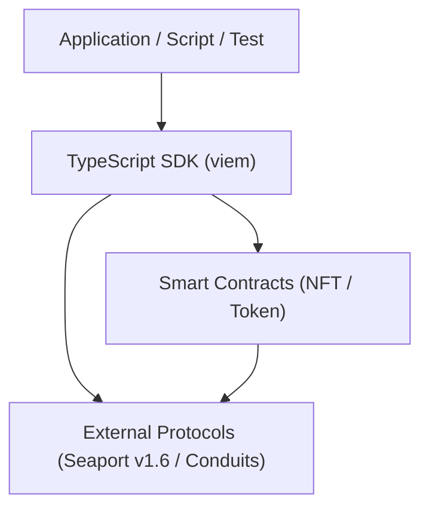
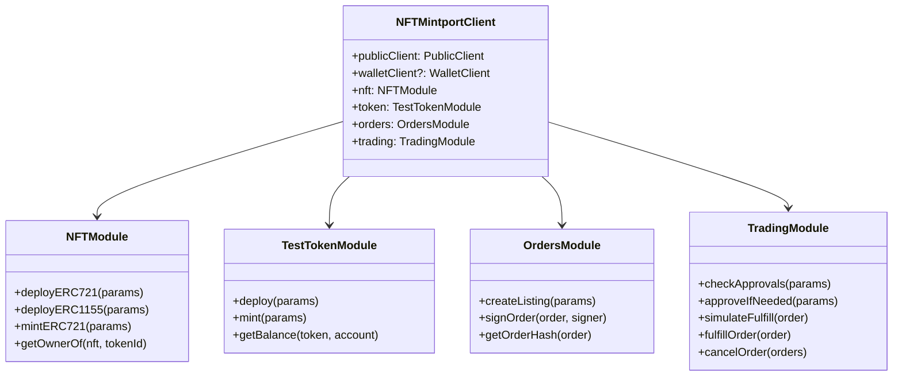

# NFTMintport — System Architecture

## 1. High-Level Architecture

The system follows a strict unidirectional dependency model:



### Layer Responsibilities
1. **Smart Contracts (`contracts/`)**:
   - The sole source of truth for on-chain state, balances, and access rules.
   - Enforce CEI, custom errors, and event emission.
   - Default to immutable contracts (non-upgradeable).
2. **TypeScript SDK (`sdk/`)**:
   - Built with `viem` (`PublicClient`, `WalletClient`).
   - Contract ABI consumer (ABIs generated by Hardhat).
   - Provides semantic APIs: read state, simulate transactions, write transactions.
   - Seaport v1.6 order building, hash calculation, EIP-712 typed data signing, and fulfillment transaction synthesis.
   - Never acts as a security boundary.
3. **External Protocols**:
   - Seaport v1.6 canonical deployment (or local test deployment where canonical is absent).
   - ERC-20 / ERC-721 standard interfaces.

---

## 2. Monorepo Directory Structure

Adhering strictly to the protocol standard:

```text
NFTMintport/
├── contracts/                  # Solidity Smart Contracts
│   ├── nft/
│   │   ├── NFTMintportERC721.sol
│   │   └── NFTMintportERC1155.sol
│   └── token/
│       └── TestMintToken.sol
├── test/                       # Hardhat Contract & Integration Tests
│   ├── unit/
│   │   ├── NFTMintportERC721.test.ts
│   │   ├── NFTMintportERC1155.test.ts
│   │   └── TestMintToken.test.ts
│   └── e2e/
│       └── seaport-trading.test.ts
├── scripts/                    # Deployment & Utility Scripts
│   ├── deploy-nft.ts
│   ├── deploy-test-token.ts
│   └── verify-deployment.ts
├── deployments/                # Saved deployment manifests (<network>-<chainId>.json)
├── sdk/                        # TypeScript SDK
│   ├── src/
│   │   ├── client.ts           # NFTMintportClient entrypoint
│   │   ├── abi/                # Exported contract ABIs
│   │   ├── modules/
│   │   │   ├── nft.ts          # NFT management module
│   │   │   ├── token.ts        # Test token module
│   │   │   ├── orders.ts       # Seaport order builder & signer
│   │   │   └── trading.ts      # Fulfillment & approvals
│   │   ├── types/              # Domain & Seaport types
│   │   └── utils/              # Chain config & validation
│   └── tsconfig.json
├── docs/                       # Project & Agent Documentation
│   ├── AI/                     # Agent Protocol state & memory
│   │   ├── GOAL.md
│   │   ├── ARCHITECTURE.md
│   │   ├── DECISIONS.md
│   │   ├── TASK_INDEX.md
│   │   ├── SESSION_STATE.md
│   │   └── tasks/
│   ├── DEPLOYMENT.md
│   └── nftmintport-architecture.md
├── hardhat.config.ts
├── package.json
├── tsconfig.json
├── .env.example
├── AGENTS.md
└── CONTRIBUTING.md
```

---

## 3. Smart Contract Specifications

### 3.1 `NFTMintportERC721.sol`
- **Inheritance:** `@openzeppelin/contracts/token/ERC721/extensions/ERC721URIStorage.sol`, `@openzeppelin/contracts/access/Ownable.sol`.
- **Constructor Parameters:** `name` (string), `symbol` (string), `initialOwner` (address).
- **Functions:**
  - `mint(address to, string memory uri)`: restricted to Owner or authorized minter. Returns `tokenId`.
  - `burn(uint256 tokenId)`: restricted to owner of token or approved operator.
- **Custom Errors:**
  - `ZeroAddressRecipient()`
  - `UnauthorizedMinter(address caller)`
  - `EmptyTokenURI()`
- **Events:**
  - `NFTMinted(address indexed to, uint256 indexed tokenId, string uri)`

### 3.2 `NFTMintportERC1155.sol`
- **Inheritance:** `@openzeppelin/contracts/token/ERC1155/extensions/ERC1155Supply.sol`, `@openzeppelin/contracts/access/Ownable.sol`.
- **Constructor Parameters:** `uri` (string), `initialOwner` (address).
- **Functions:**
  - `mint(address to, uint256 id, uint256 amount, bytes memory data)`: restricted to Owner.
  - `mintBatch(address to, uint256[] memory ids, uint256[] memory amounts, bytes memory data)`.
  - `setURI(string memory newUri)`.
- **Custom Errors:**
  - `ZeroAddressRecipient()`
  - `InvalidAmount()`

### 3.3 `TestMintToken.sol`
- **Inheritance:** `@openzeppelin/contracts/token/ERC20/ERC20.sol`.
- **Purpose:** Permissionless-mint test token for testnets and local testing.
- **Constants:** `MAX_MINT_PER_CALL = 1_000_000 ether`.
- **Functions:**
  - `mint(address to, uint256 amount) external`: anyone can mint up to `MAX_MINT_PER_CALL` per transaction.
- **Custom Errors:**
  - `ZeroAddressRecipient()`
  - `InvalidMintAmount()`
  - `ExceedsMaxMintPerCall(uint256 requested, uint256 maxAllowed)`
- **Events:**
  - Standard ERC-20 `Transfer(address(0), to, amount)`
  - `TestTokenMinted(address indexed to, uint256 amount)`

---

## 4. Seaport Protocol Integration

- **Protocol Version:** Seaport v1.6.
- **Deployment Discovery:**
  - Seaport v1.6 uses a deterministic Create2 deployment address across supported EVM chains:
    `0x0000000000000068F116a894984e2DB1123eB395`
  - Conduit Controller canonical address:
    `0x00000000F9490004C103FB2A09CE222342427011`
- **Trading Flow:**
  1. **Listing Creation:** Seller specifies Offer (NFT address, ID) and Consideration (ERC-20 token / Native ETH, amount, recipient).
  2. **EIP-712 Sign:** Seller signs the typed order hash using Seaport v1.6 domain (`Seaport`, `1.6`, `chainId`, `seaportAddress`).
  3. **Approval:** Seller approves Seaport (or Conduit) for NFT. Buyer approves Seaport for consideration tokens.
  4. **Fulfillment:** Buyer invokes `fulfillOrder` or `fulfillAdvancedOrder` on Seaport.
  5. **Settlement:** Atomic execution verified on-chain.

---

## 5. TypeScript SDK (`viem`) Architecture



All transaction mutations follow the `viem` best practice:
```ts
// 1. Simulate
const { request } = await publicClient.simulateContract({ ... });
// 2. Execute
const hash = await walletClient.writeContract(request);
// 3. Await receipt
const receipt = await publicClient.waitForTransactionReceipt({ hash });
```

---

## 6. Mathematical Invariants & Security Model

1. **Asset Conservation:** Sum of consideration amounts delivered exactly equals agreed amounts.
2. **Atomic Settlement:** Either both NFT transfer and payment occur, or transaction reverts entirely.
3. **SafeERC20:** All token interactions handle non-standard ERC-20 returns (missing boolean returns).
4. **No Unrestricted Reentrancy:** CEI applied across all contracts.
5. **Network Segregation:** Mainnet deployment requires explicit manual parameter flags. `TestMintToken` warns and requires explicit confirmation on non-local networks.
