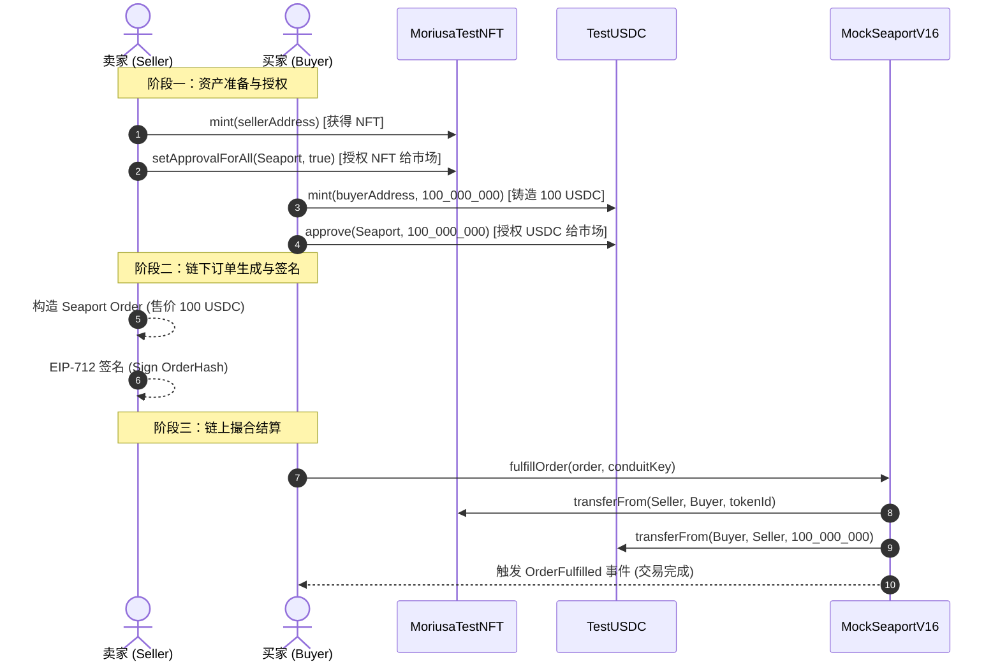

# Soneium Minato 测试网合约交互操作指南 (Blockscout Explorer Guide)

本文档详细说明如何在 **Soneium Minato 测试网 Blockscout 区块浏览器** 上直接操作已开源验证的 3 个核心合约：
1. **`TestUSDC`** (测试 ERC-20 代币)
2. **`MoriusaTestNFT`** (Moriusa 主 NFT 集合，ERC-721)
3. **`MockSeaportV16`** (Seaport v1.6 撮合交易市场合约)

---

## 目录
- [1. 准备工作](#1-准备工作)
- [2. 核心合约概览与链接](#2-核心合约概览与链接)
- [3. TestUSDC 操作指南 (铸造与授权)](#3-testusdc-操作指南-铸造与授权)
- [4. MoriusaTestNFT 操作指南 (单铸、批量铸造与授权)](#4-moriusatestnft-操作指南-单铸批量铸造与授权)
- [5. MockSeaportV16 交易与撤单指南](#5-mockseaportv16-交易与撤单指南)
- [6. 完整业务交互时序 (NFT 交易流程)](#6-完整业务交互时序-nft-交易流程)
- [7. 常见报错与排查清单](#7-常见报错与排查清单)
- [8. 自动化脚本化操作](#8-自动化脚本化操作)

---

## 1. 准备工作

### 1.1 钱包配置 Soneium Minato 网络
在 MetaMask 或 OKX Web3 钱包中添加自定义网络：
- **网络名称 (Network Name)**: `Soneium Minato Testnet`
- **RPC URL**: `https://rpc.minato.soneium.org`
- **链 ID (Chain ID)**: `1946`
- **货币符号 (Currency Symbol)**: `ETH`
- **区块浏览器 (Block Explorer)**: `https://soneium-minato.blockscout.com`

> [!TIP]
> 确保你的测试钱包中有少量 Minato 测试网 ETH 作为 Gas 费。

### 1.2 在 Blockscout 上连接钱包
打开任意合约页面后：
1. 切换到 **“Contract”** 选项卡。
2. 点击 **“Write Contract”**（写合约）子标签。
3. 点击 **“Connect Wallet”** 按钮连接 MetaMask 或目标钱包，确认网络为 Minato (1946)。

---

## 2. 核心合约概览与链接

| 合约名称 | 链上地址 | 精度/标准 | Blockscout 快捷入口 |
| :--- | :--- | :---: | :--- |
| **`TestUSDC`** | `0x2C2e569e3Df89c55Ba46Ce52248Ae180379d0B31` | 6 Decimals / ERC-20 | [查看合约](https://soneium-minato.blockscout.com/address/0x2C2e569e3Df89c55Ba46Ce52248Ae180379d0B31) |
| **`MoriusaTestNFT`** | `0xc252a473DC466de3799149A2616ccc625832F40C` | ERC-721 + URIStorage | [查看合约](https://soneium-minato.blockscout.com/address/0xc252a473DC466de3799149A2616ccc625832F40C) |
| **`MockSeaportV16`** | `0xbae7B318A137b68eB78c1f22e5B59FcDf4d50E19` | Seaport v1.6 撮合协议 | [查看合约](https://soneium-minato.blockscout.com/address/0xbae7B318A137b68eB78c1f22e5B59FcDf4d50E19) |

---

## 3. TestUSDC 操作指南 (铸造与授权)

> 页面入口: [TestUSDC -> Write Contract](https://soneium-minato.blockscout.com/address/0x2C2e569e3Df89c55Ba46Ce52248Ae180379d0B31?tab=write_contract)

> [!IMPORTANT]
> **USDC 精度注意**：`TestUSDC` 采用与官方 USDC 相同的 **6 位小数**（1 USDC = `1,000,000` 最小单位）。单笔最大铸造上限为 `1,000,000` USDC。

### 3.1 铸造测试币 (mint)
用于给任意地址无门槛铸造测试 USDC：
- **函数名**: `mint(address to, uint256 amount)`
- **参数说明**:
  - `to`: 接收代币的钱包地址（例如你的钱包地址）。
  - `amount`: 铸造数量（注意 6 位小数）：
    - 铸造 100 USDC：填入 `100000000` (100 * 10^6)
    - 铸造 1,000 USDC：填入 `1000000000` (1,000 * 10^6)
    - 铸造 10,000 USDC：填入 `10000000000` (10,000 * 10^6)
- **操作**: 填好后点击 **Write** 并在钱包中签名交易。

### 3.2 授权 Seaport 市场扣款 (approve)
当作为买家出资购买 NFT 时，必须先授权 Seaport 协议扣减相应的 USDC：
- **函数名**: `approve(address spender, uint256 amount)`
- **参数说明**:
  - `spender`: Seaport 合约地址，填入 `0xbae7B318A137b68eB78c1f22e5B59FcDf4d50E19`
  - `amount`: 授权额度，填入足够数量，例如无限授权 `115792089237316195423570985008687907853269984665640564039457584007913129639935` (即 `type(uint256).max`)，或单次交易额度 `100000000` (100 USDC)。
- **操作**: 点击 **Write** 并确认。

### 3.3 查询余额与授权额度 (Read Contract)
- `balanceOf(account)`: 查询某地址当前持有的 USDC 数量（除以 10^6 即为代币实际数量）。
- `allowance(owner, spender)`: 输入你的地址和 Seaport 合约地址，确认是否已成功授权。

---

## 4. MoriusaTestNFT 操作指南 (单铸、批量铸造与授权)

> 页面入口: [MoriusaTestNFT -> Write Contract](https://soneium-minato.blockscout.com/address/0xc252a473DC466de3799149A2616ccc625832F40C?tab=write_contract)

### 4.1 单枚快速铸造 (mint)
使用合约默认的 IPFS 元数据一键为指定地址铸造 1 枚 NFT：
- **函数名**: `mint(address to)`
- **参数说明**:
  - `to`: 接收 NFT 的钱包地址。
- **操作**: 点击 **Write** 并确认，交易成功后事件日志中会输出分配的 `tokenId`。

### 4.2 批量铸造 (mintBatch)
支持单笔交易批量铸造多枚 NFT（每笔交易上限 50 枚，有效节省 Gas）：
- **函数名**: `mintBatch(address to, uint256 count)`
- **参数说明**:
  - `to`: 接收 NFT 的钱包地址。
  - `count`: 铸造数量（输入范围 `1` ~ `50`，例如输入 `10` 即可一次性获得 10 枚 NFT）。
- **操作**: 点击 **Write** 并确认。

### 4.3 授权 Seaport 市场托管与转移 (setApprovalForAll)
当作为卖家在 Seaport 上挂单出售 NFT 时，必须事先将合约授权给 Seaport：
- **函数名**: `setApprovalForAll(address operator, bool approved)`
- **参数说明**:
  - `operator`: Seaport 合约地址，填入 `0xbae7B318A137b68eB78c1f22e5B59FcDf4d50E19`
  - `approved`: 填入 `true`
- **操作**: 点击 **Write** 并确认。

### 4.4 销毁 NFT (burn)
只有 NFT 持有者或已授权的 Operator 才能销毁代币：
- **函数名**: `burn(uint256 tokenId)`
- **参数说明**:
  - `tokenId`: 需要销毁的代币 ID。

### 4.5 常用查询功能 (Read Contract)
- `balanceOf(owner)`: 查看某账户当前持有的 Moriusa NFT 总数量。
- `ownerOf(tokenId)`: 查询某特定 Token ID 当前的归属所有者地址。
- `tokenURI(tokenId)`: 查看元数据链接（默认为 `ipfs://bafybeic7vcmk2xxdv234bylg2n2q6o52kgh6tqu5i4w2p3yfxq6a2m4k6e/moriusa.json`）。
- `totalMinted()`: 当前集合全网累计已铸造的 NFT 总数。

---

## 5. MockSeaportV16 交易与撤单指南

> 页面入口: [MockSeaportV16 -> Write Contract](https://soneium-minato.blockscout.com/address/0xbae7B318A137b68eB78c1f22e5B59FcDf4d50E19?tab=write_contract)

Seaport 遵循标准的 **链下签名 (Off-Chain EIP-712 Order) + 链上撮合 (On-Chain Settlement)** 机制：
1. **卖家挂单**：完全无需 Gas，卖家在链下生成并对订单签名。
2. **买家购买**：买家调用 `fulfillOrder` 将卖家的订单及签名提交上链完成原子结算。

### 5.1 批量作废所有历史挂单 (incrementCounter)
如果你此前签过订单但想**立即作废失效所有历史挂单**，无需逐个订单取消，调用 `incrementCounter` 即可：
- **函数名**: `incrementCounter()`
- **参数说明**: 无参数。
- **原理**: 你的计数器 +1，所有包含旧 counter 的订单哈希全部失效。
- **操作**: 点击 **Write** 并确认。

### 5.2 链上取消特定订单 (cancel)
- **函数名**: `cancel(components[])`
- **参数说明**: 传入你的订单组件数组。
- **权限安全**: 只有挂单者本人（`offerer == msg.sender`）才可以成功执行取消。

### 5.3 链上撮合购买订单 (fulfillOrder)
买家调用此函数执行交易：
- **函数名**: `fulfillOrder(order, fulfillerConduitKey)`
- **参数结构**:
  - `order`: 包含 `parameters` 和 `signature`。
  - `fulfillerConduitKey`: 填入默认零字节哈希 `0x0000000000000000000000000000000000000000000000000000000000000000`。
- **原生 ETH 支付**: 若订单卖方要求 Native ETH，需在调用时在交易附带发送的 `value` 字段填入相应 ETH 数额（溢出部分合约会自动退还）。

---

## 6. 完整业务交互时序 (NFT 交易流程)



---

## 7. 常见报错与排查清单

| 自定义错误 / 提示 | 产生原因 | 解决方法 |
| :--- | :--- | :--- |
| `ExceedsMaxMintPerCall` | `TestUSDC.mint` 单笔超过 1,000,000 代币，或 `MoriusaTestNFT.mintBatch` 单笔超过 50 枚 | 减少输入数量，在安全限制内多次调用。 |
| `ZeroAddressRecipient` | 铸造给零地址 `0x0000...0000` | 确保传入有效的钱包地址。 |
| `UnauthorizedCaller` | 尝试烧毁非本人名下且未授权的 NFT；或尝试取消他人的 Seaport 订单 | 检查当前连接的钱包是否为该资产的所有者。 |
| `OrderExpired` | 订单的 `endTime` 早于当前区块时间戳 | 检查挂单设定的有效期，重新生成有效挂单。 |
| `OrderNotYetActive` | 订单设定的 `startTime` 晚于当前时间戳 | 等待挂单生效时间到达后再执行撮合。 |
| `InsufficientValue` | 购买以原生 ETH 计价的订单时，发送的 `msg.value` 低于售价 | 在调用 `fulfillOrder` 时随交易附带足额的 ETH。 |
| `ERC20InsufficientAllowance` | 买家在调用 Seaport 购买前未对 USDC 进行 `approve` | 先前往 TestUSDC 合约调用 `approve(Seaport, 额度)`。 |

---

## 8. 自动化脚本化操作

由于 Seaport 的 EIP-712 签名与 Tuple 参数在区块浏览器手工输入相对繁琐，本项目已随附完整的**一键端到端自动化模拟交易脚本**。

你只需在根目录配置 `.env` 中的私钥，即可一键自动执行：
`自主铸造 NFT` -> `自主铸造 USDC` -> `生成临时对手方钱包` -> `链下签名订单` -> `调用 Seaport 撮合` -> `验证资产转移`。

### 运行指令：
```bash
npx ts-node scripts/simulate-minato-flow.ts
```

---

## 9. 高级验证指南：按地址单验、白名单筛选与隐私过滤 (Selective Verification)

如果你只想开源验证某一个特定地址，或者某个配置文件中的部分合约，而对于私有商业逻辑合约**不希望开源**，可使用提供的灵活验证命令：

### 9.1 直接按单地址验证 (Single Address Verification)
无需传入清单文件，直接指定地址与合约名即可验证：
```bash
# 语法
pnpm run verify --address <合约地址> --contract <合约名>

# 示例：仅验证 TestUSDC 地址
pnpm run verify --address 0x2C2e569e3Df89c55Ba46Ce52248Ae180379d0B31 --contract TestUSDC

# 示例：简写语法（自动识别 0x 地址）
pnpm run verify 0x2C2e569e3Df89c55Ba46Ce52248Ae180379d0B31 --contract TestUSDC
```

### 9.2 白名单模式：仅验证指定合约 (--only)
如果你只想验证清单/配置中的某几个合约：
```bash
pnpm run verify --manifest deployments/soneium-minato-1946.json --only MoriusaTestNFT,TestUSDC
```

### 9.3 黑名单/隐私过滤：跳过指定不想开源的合约 (--exclude / --skip)
如果有某些私有业务逻辑或敏感合约，**严禁开源**：
```bash
# 跳过 Seaport 合约，只开源其他合约
pnpm run verify --manifest deployments/soneium-minato-1946.json --exclude Seaport

# 或使用 --skip 别名
pnpm run verify --manifest deployments/soneium-minato-1946.json --skip Seaport,PrivateVault
```

### 9.4 配置文件级永久禁止开源 (`verify: false` / `skipVerify: true`)
在任何部署配置文件（如 `deploy.minato.config.json` 或 `deploy.config.json`）中，给不想开源的合约增加 `"verify": false` 或 `"skipVerify": true`，验证脚本会自动跳过：
```json
{
  "chainId": 1946,
  "contracts": {
    "MoriusaTestNFT": {
      "enabled": true,
      "verify": true
    },
    "ProprietaryMarketLogic": {
      "enabled": true,
      "verify": false
    }
  }
}
```
运行验证时会显示：
```text
🔒 [SKIP / NON-OPEN-SOURCE] [ProprietaryMarketLogic] at 0x...
   Reason: marked "verify": false in configuration
```

### 9.5 预检模式 (--dry-run)
在实际发起网络请求前，可使用 `--dry-run` 预览哪些合约会被验证、哪些会被跳过：
```bash
pnpm run verify --manifest deployments/soneium-minato-1946.json --exclude Seaport --dry-run
```

