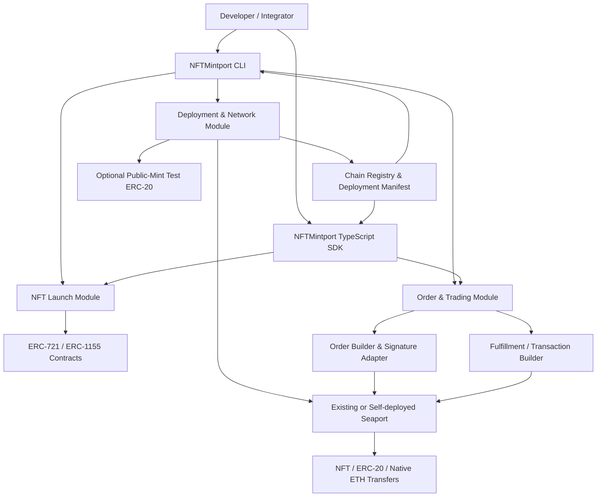

# NFTMintport Architecture

> NFT Launch & Trading Toolkit for EVM chains  
> Status: Proposed architecture · Version: 0.1.0

## 1. Overview

NFTMintport is an open-source toolkit for launching NFT collections and enabling NFT trading through Seaport. It provides a developer CLI, reusable TypeScript SDKs, deployment/configuration tooling, example workflows, and an optional public-mint test ERC-20 token.

Core capabilities:

- Deploy and configure ERC-721 / ERC-1155 NFT collections.
- Detect and configure an existing Seaport deployment, or deploy a compatible instance when explicitly requested.
- Create, sign, validate, cancel, and fulfill NFT orders.
- Optionally deploy a test ERC-20 token that anyone can mint, for end-to-end testing of token-denominated purchases.
- Run repeatable local-chain and testnet workflows.

**Non-goal for the initial release:** building a full hosted marketplace, centralized order indexer, custodial wallet, or production token economy.

## 2. Product principles

1. **Reuse before redeploying.** Prefer verified Seaport deployments on a target chain. Make protocol deployment an explicit operation.
2. **Network-aware safety.** Every deployment and transaction must display chain ID, network, contract address, and whether the environment is local, testnet, or mainnet.
3. **Test assets are unmistakable.** The public-mint token is named and documented as a test token; it must never be presented as a stablecoin or real-value asset.
4. **Keep protocol logic upstream.** Use the official Seaport contracts and supported SDK interfaces rather than reimplementing order validation or settlement.
5. **Reproducible deployments.** Save deployment manifests with chain ID, addresses, compiler/build metadata, protocol version, and transaction hashes.
6. **No implicit trust.** Verify contract addresses and bytecode/source where possible; do not infer that a contract is official based only on its name or symbol.

## 3. High-level architecture



The diagram shows logical modules, not a requirement to deploy all components in every environment.

## 4. Proposed repository structure

```text
nftmintport/
├── apps/
│   └── cli/                       # `nftmintport` command-line app
├── packages/
│   ├── core/                      # shared types, errors, chain utilities
│   ├── config/                    # chain registry, manifests, address checks
│   ├── contracts-nft/              # NFT contract interfaces and deploy helpers
│   ├── contracts-test-token/        # test ERC-20 interface and deploy helper
│   ├── seaport-adapter/             # official Seaport SDK integration
│   ├── orders/                     # order building, signing, validation
│   ├── trading/                    # fulfill/cancel/approval transaction helpers
│   └── testing/                    # fixtures, local-chain helpers
├── contracts/
│   ├── nft/                         # only if NFT contracts are maintained here
│   └── TestMintToken.sol            # optional unrestricted-mint test token
├── examples/
│   ├── deploy-nft/
│   ├── deploy-test-token/
│   ├── list-nft-for-eth/
│   ├── list-nft-for-erc20/
│   └── buy-nft-with-test-token/
├── test/
│   ├── unit/
│   ├── integration/
│   └── e2e/
├── docs/
│   ├── architecture.md
│   ├── security.md
│   └── workflows.md
├── deployments/                    # generated manifests; avoid secrets
├── scripts/
├── package.json
└── README.md
```

Keep contract source, SDK code, and CLI concerns separate. If the project only wraps third-party NFT implementations, `contracts-nft/` can be deployment adapters rather than maintaining custom NFT contracts.

## 5. Main modules

### 5.1 NFT Launch

Responsibilities:
- Deploy a chosen ERC-721 or ERC-1155 implementation.
- Configure name, symbol, base URI, supply/role settings supported by that implementation.
- Optionally mint a first NFT or provide a separate mint command.
- Record contract address and deployment transaction in the manifest.
- Verify network and constructor parameters before broadcasting.

Design notes:
- Keep the first version's NFT contract surface small and well-tested.
- Clearly document owner/admin powers, mint permissions, upgradeability, and royalty behavior.
- Do not imply that marketplace royalties are automatically enforced by Seaport; behavior depends on the order and marketplace implementation.

### 5.2 Seaport deployment and adapter

Two explicit modes:

- **`existing` (recommended default):** use a verified Seaport deployment supported on the selected chain and configured version.
- **`deploy`:** deploy a compatible version only when supported and intentionally requested.

Responsibilities:
- Resolve chain ID to a known deployment configuration.
- Validate the configured Seaport and ConduitController addresses.
- Expose typed interfaces for order creation, cancellation, validation, and fulfillment.
- Use the official Seaport SDK/API patterns compatible with the selected protocol version.
- Store version, addresses, and deployment transaction hashes.

Important: deploying Seaport alone does not provide a hosted marketplace, order discovery/indexing, frontend, or a complete orderbook. NFTMintport's first release can operate with manually supplied orders and examples; a persistent order indexer can be a later module.

### 5.3 Order and trading module

Responsibilities:
- Build Seaport orders with explicit offer and consideration items.
- Support native ETH and ERC-20 consideration, including the test token.
- Sign orders using the connected wallet/signer.
- Build approval and fulfillment transactions.
- Check order expiry, token balance, NFT ownership, approvals, and chain ID where practical.
- Provide cancel and status-check helpers.

Suggested API surface (illustrative, not final implementation):

```ts
const client = await NFTMintport.connect({
  chainId,
  signer,
  seaport: { mode: "existing" },
});

const collection = await client.nft.deployERC721({
  name: "Demo Collection",
  symbol: "DEMO",
});

const token = await client.testToken.deploy({
  name: "NFTMintport Test Token",
  symbol: "NMTT",
});

await client.testToken.mint({
  token: token.address,
  to: buyerAddress,
  amount: parseUnits("1000", 18),
});

// Seller creates an order that asks for the test ERC-20 token.
// Buyer approves the relevant transfer path, then fulfills the order.
const order = await client.orders.createListing({
  nft: collection.address,
  tokenId: 1n,
  consideration: {
    type: "erc20",
    token: token.address,
    amount: parseUnits("25", 18),
    recipient: sellerAddress,
  },
});

const signedOrder = await client.orders.sign(order);
await client.trading.fulfillOrder({ order: signedOrder });
```

The API above is a proposed interface. Exact calls must be implemented against the selected official Seaport SDK version and the repository's chosen wallet/provider library.

### 5.4 Public-mint test ERC-20

Purpose: provide a predictable, valueless token for local development, testnets, demos, and automated end-to-end tests.

Proposed behavior:
- Standard ERC-20 semantics.
- Anyone can mint to their own address or a specified recipient.
- Configurable mint amount and decimals only if needed; default to 18 decimals.
- No owner-only mint gate in test mode, because permissionless minting is the requirement.
- Emit standard `Transfer` events and follow OpenZeppelin ERC-20 conventions.
- Include a prominent test-only warning in contract docs, CLI output, UI labels, and example configuration.
- Do not add a peg, redemption promise, profit claim, or misleading “stable” terminology.
- Do not deploy automatically to mainnet. Require explicit opt-in on public networks and show a warning.

Potential contract sketch:

```solidity
// SPDX-License-Identifier: MIT
pragma solidity ^0.8.24;

import {ERC20} from "@openzeppelin/contracts/token/ERC20/ERC20.sol";

/// @notice Test-only token. Anyone can mint; it has no intended real-world value.
contract TestMintToken is ERC20 {
    uint256 public constant MAX_MINT_PER_CALL = 1_000_000 ether;

    constructor() ERC20("NFTMintport Test Token", "NMTT") {}

    function mint(address to, uint256 amount) external {
        require(to != address(0), "zero recipient");
        require(amount > 0 && amount <= MAX_MINT_PER_CALL, "invalid amount");
        _mint(to, amount);
    }
}
```

The per-call limit is optional friction, not a scarcity guarantee: anyone can call `mint` repeatedly, so total supply is intentionally unbounded. If the desired behavior is absolutely unrestricted minting, remove the per-call limit but retain clear test-only labeling. Pin and test a compatible OpenZeppelin version before implementation.

### 5.5 Configuration and deployment manifests

Example generated manifest:

```json
{
  "schemaVersion": 1,
  "project": "NFTMintport",
  "environment": "local",
  "chainId": 31337,
  "contracts": {
    "nftCollection": {
      "address": "0x...",
      "standard": "ERC721",
      "deploymentTx": "0x..."
    },
    "testToken": {
      "address": "0x...",
      "symbol": "NMTT",
      "testOnly": true,
      "deploymentTx": "0x..."
    },
    "seaport": {
      "mode": "existing",
      "version": "...",
      "address": "0x...",
      "conduitController": "0x..."
    }
  }
}
```

All `0x...` values are placeholders, not actual deployment addresses. Never commit private keys, seed phrases, RPC credentials, or API secrets to manifests.

## 6. End-to-end workflows

### Workflow A: local test environment

1. Start a local EVM node (for example, Anvil).
2. Load a local deployer/buyer/seller account set.
3. Deploy an NFT collection.
4. Deploy the permissionless-mint test ERC-20.
5. Use an existing local-compatible Seaport deployment or deploy the pinned supported version and required companion components.
6. Mint an NFT to the seller.
7. Mint test tokens to the buyer.
8. Seller approves the relevant NFT transfer path and signs an order asking for the test ERC-20.
9. Buyer approves the required ERC-20 transfer path.
10. Buyer fulfills the order through Seaport.
11. Assert NFT ownership, seller token balance, buyer token balance, order status, and emitted events.

### Workflow B: buy with test ERC-20

- Seller creates an order whose consideration includes the test token address and exact amount.
- Buyer receives test tokens by calling the public `mint` function.
- Buyer approves the appropriate Seaport/conduit transfer path according to the configured deployment.
- Buyer fulfills the order.
- The test verifies that the NFT and tokens moved atomically, or that the transaction reverted without partial settlement.

### Workflow C: buy with native ETH

- Seller creates a listing with native-ETH consideration.
- Buyer calls the fulfillment flow with the required value and order parameters.
- Tests validate the amount and all recipients.

The exact fulfillment value, criteria handling, conduit selection, and approval target depend on the order shape and Seaport version; the adapter should derive these from the official SDK rather than hard-code assumptions.

## 7. CLI proposal

Illustrative command names:

```bash
# Inspect target network
nftmintport network inspect

# Deploy an NFT collection
nftmintport nft deploy --standard erc721 --name "Demo" --symbol DEMO

# Deploy test-only ERC-20
nftmintport token deploy-test

# Anyone can mint test tokens
nftmintport token mint --token <address> --to <wallet> --amount 1000

# Configure Seaport
nftmintport seaport use-existing
nftmintport seaport deploy --version <pinned-version>  # explicit opt-in

# Trading workflow
nftmintport order create-listing --nft <address> --token-id 1 --price 25 --currency <erc20-address>
nftmintport order inspect --order <file>
nftmintport trade fulfill --order <file>
```

CLI syntax is illustrative. Commands that sign or broadcast transactions should always show the target chain and contract addresses before execution, with a confirmation option for non-local networks.

## 8. Security requirements

- Pin the Seaport protocol and SDK versions; document the exact compatibility matrix.
- Use official deployment addresses and verify source/bytecode when possible.
- Never silently deploy a new Seaport instance or switch a configured address.
- Validate chain ID before signing or broadcasting.
- Keep secrets in environment variables or a secure signer; never in the repository.
- Treat all order JSON, token addresses, RPC responses, and user-provided contract addresses as untrusted input.
- Test malicious or invalid orders, expired orders, insufficient balances, missing approvals, replay/cancellation cases, and reverted transfers.
- The public-mint token is test-only and must be clearly identified as having no intended real-world value.
- Avoid deploying test token contracts on mainnet by default; require an explicit override and prominent warning.
- Audit custom contracts before production use. Prefer minimal, established contract libraries.
- Do not promise royalties or orderbook discovery unless the implementation explicitly provides them.

## 9. Testing strategy

| Layer | Coverage |
|---|---|
| Unit | config validation, amount parsing, manifest schema, order-building helpers |
| Contract | NFT mint/ownership, test token mint behavior, zero address/invalid amount cases |
| Integration | SDK compatibility with pinned Seaport version, approvals, signatures |
| E2E | mint NFT → mint test ERC-20 → list → fulfill → assert asset balances |
| Failure paths | expired order, wrong chain, wrong currency, insufficient balance, missing approval, canceled order |
| CI | local EVM, deterministic fixtures, lint, typecheck, unit/integration tests |

## 10. Suggested implementation phases

### Phase 1 — Foundation
- TypeScript workspace, lint/typecheck/test setup.
- Chain configuration and deployment manifest.
- Local EVM integration.
- NFT deployment example.

### Phase 2 — Test token
- Permissionless-mint ERC-20.
- Test-only warnings and network safeguards.
- Unit tests and CLI commands.

### Phase 3 — Seaport adapter
- Pin protocol/SDK versions.
- Existing deployment registry and validation.
- Optional explicit deployment workflow for supported networks.
- Integration tests against the chosen version.

### Phase 4 — Trading
- NFT listing with native ETH.
- Listing with ERC-20 consideration.
- Test-token purchase end-to-end.
- Cancellation, order inspection, and failure-path tests.

### Phase 5 — Developer experience
- README quick start, examples, API docs.
- Testnet guide and deployment verification.
- Optional order storage/indexer and UI as separate future modules.

## 11. Decisions to settle before implementation

1. Which EVM networks are in scope initially (local Anvil only, testnets, or named mainnets)?
2. Which NFT implementations should be supported first (ERC-721, ERC-1155, or both)?
3. Which Seaport version and official SDK version will be pinned?
4. Should public-mint test tokens be allowed on testnets only, or on any network with an explicit warning?
5. Is the first release CLI + SDK only, or should it include a demo web UI and order indexer?

## 12. Definition of done for the first useful release

A developer can run the documented local setup and, from a clean local chain:

- deploy an NFT collection;
- deploy the permissionless-mint test ERC-20;
- mint an NFT to a seller and test tokens to a buyer;
- create and sign a Seaport listing denominated in the test token;
- fulfill it from the buyer account;
- verify NFT ownership and token balance changes;
- run the same flow in CI without real funds or secrets.

---

**Naming:** `NFTMintport`  
**One-line description:** *An open-source toolkit for launching NFT collections and enabling Seaport-powered trading, with an optional permissionless-mint test ERC-20 for development and end-to-end testing.*
